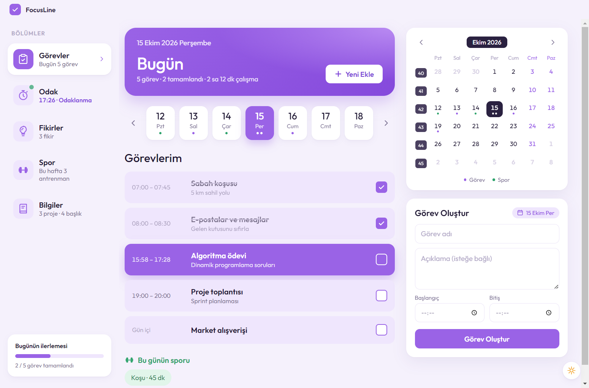
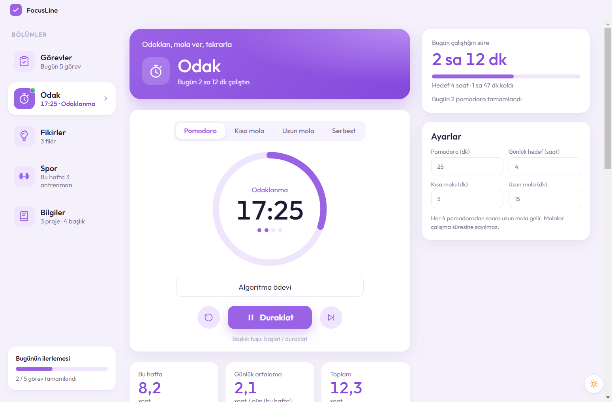
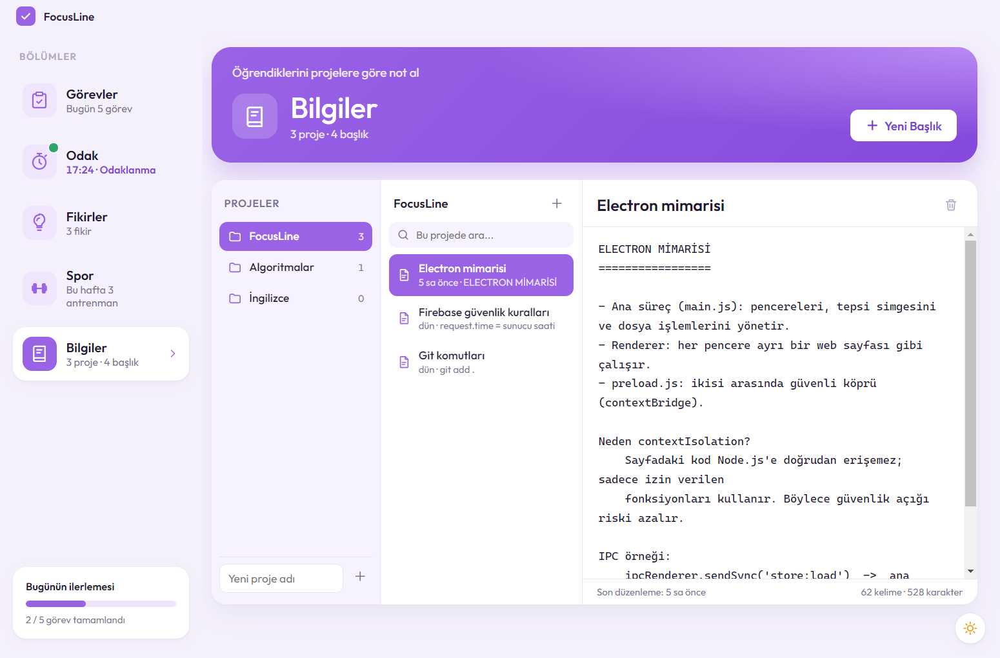
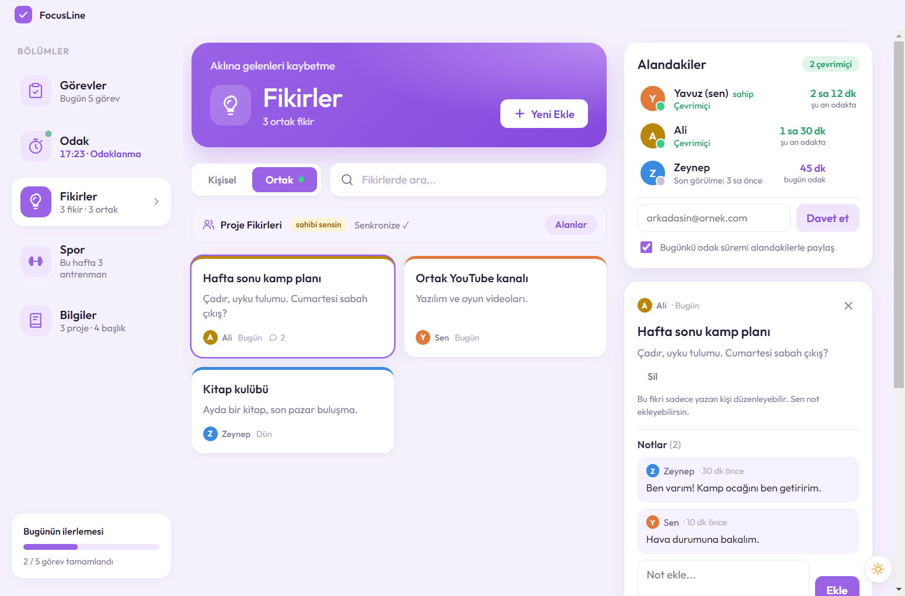
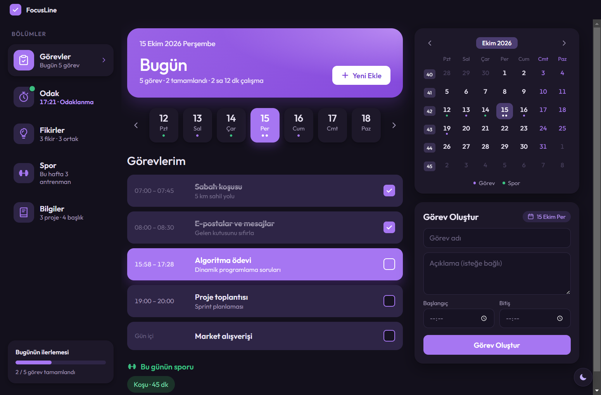
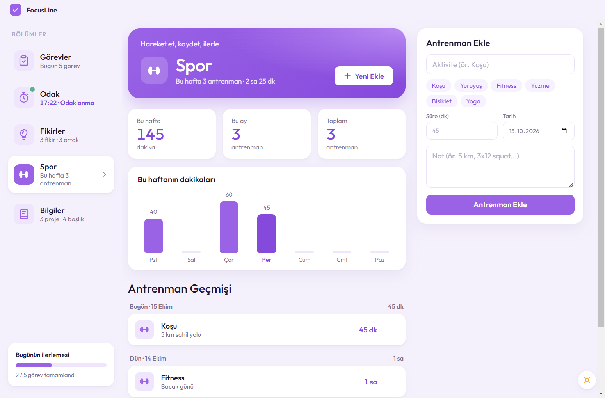

<div align="center">


# FocusLine

**Görevlerini planla, odaklan, öğrendiklerini not al, fikirlerini arkadaşlarınla paylaş.**

Takvimli görev listesi, pomodoro zamanlayıcısı, proje notları, ortak fikir alanları ve spor takibini tek bir yerde toplayan Windows masaüstü uygulaması.




</div>

---

## Özellikler

### 📋 Görevler ve takvim
- Gün gün görev listesi; haftalık şerit ve hafta numaralı aylık takvim
- Başlangıç–bitiş saati; o an süren görev vurgulanır
- Takvimde görev ve spor yapılan günler noktalarla işaretlenir
- Seçili günün çalışma süresi ve spor kaydı bir bakışta

### ⏱️ Odak (pomodoro)
- Pomodoro, kısa mola, uzun mola ve sınırsız **serbest çalışma** modları
- Duraklat → devam et aynı oturumda birikir; oturum "bitir" deyince kaydedilir
- Günlük hedef, haftalık saat grafiği ve oturum geçmişi
- Pencere kapansa da sayaç sistem tepsisinde çalışmaya devam eder

### 📚 Bilgiler
- Projeler → başlıklar → not defteri gibi düz metin notlar
- Yazarken otomatik kayıt, proje içinde arama, kelime/karakter sayacı
- `Tab` ile girinti, `Ctrl+S` ile anında kayıt

### 💡 Fikirler
- **Kişisel** fikirler yalnızca bilgisayarında kalır
- **Ortak alanlar**: e-posta + şifre ile giriş, e-postayla davet, gerçek zamanlı senkronizasyon
  - Fikri yalnızca yazan düzenler; herkes not ekleyebilir
  - Fikri yalnızca yazan ya da alan sahibi silebilir
  - "Alandakiler" listesinde kimin çevrimiçi olduğu ve bugünkü odak süreleri

### 🏃 Spor
- Antrenman kaydı (aktivite, süre, not), haftalık dakika grafiği ve geçmiş

### 🌗 Ve dahası
- Açık / karanlık tema (köşeden yayılan geçiş animasyonuyla)
- Sistem tepsisi, Windows bildirimleri, tek pencere, geri alınabilir silme

## Ekran görüntüleri

| Odak | Bilgiler |
| :---: | :---: |
|  |  |
| **Ortak fikirler** | **Karanlık tema** |
|  |  |

<details>
<summary>Spor ekranı</summary>



</details>

## Klavye kısayolları

| Kısayol | Nerede | Ne yapar |
| --- | --- | --- |
| `Ctrl+N` | Her sekme | Yeni kayıt (görev, fikir, antrenman, başlık) |
| `Boşluk` | Odak | Zamanlayıcıyı başlat / duraklat |
| `Ctrl+S` | Bilgiler | Notu hemen kaydet |
| `Tab` | Bilgiler | Girinti ekle |
| `Esc` | Formlar | Düzenlemeyi iptal et |

## Geliştirme

Gerekenler: [Node.js](https://nodejs.org) 20 veya üzeri, Windows.

```bash
git clone https://github.com/Yavuzgmus/focusline.git
cd focusline
npm install
npm start
```

### Kurulum dosyası üretme

```bash
npm run dist
```

`dist/` klasörüne iki dosya üretilir:

| Dosya | Açıklama |
| --- | --- |
| `FocusLine-Kurulum-<sürüm>.exe` | Normal kurulum (önerilen) |
| `FocusLine-Tasinabilir-<sürüm>.exe` | Kurulum gerektirmeden çalışır |

Yeni sürümden önce `package.json` içindeki `version` artırılır. `build.appId` değiştirilmemelidir: Windows, yeni kurulumun eskisinin yerini alacağını bu kimlikten anlar.

## Proje yapısı

```
src/
├── main.js                Ana süreç: pencere, sistem tepsisi, dosyaya kayıt, tema
├── preload.js             Ana süreç ile arayüz arasındaki güvenli köprü
├── renderer/
│   ├── index.html         Arayüz iskeleti
│   ├── styles.css         Tasarım (açık ve karanlık tema)
│   └── renderer.js        Uygulama mantığı
└── shared/
    ├── shared.js          Ortak alanlar: Firebase giriş + Firestore senkronizasyonu
    └── firebase-config.js Firebase proje ayarları
assets/                    Uygulama ikonu
docs/screenshots/          README görselleri
firestore.rules            Firestore güvenlik kuralları
```

`src/shared/shared.js`, [esbuild](https://esbuild.github.io) ile `src/renderer/shared.bundle.js` dosyasına paketlenir. Bu dosya `npm start` / `npm run dist` sırasında otomatik üretilir ve depoda tutulmaz.

## Kullanılan teknolojiler

- [Electron](https://www.electronjs.org): masaüstü uygulama çatısı
- Saf HTML, CSS ve JavaScript (arayüz çerçevesi yok)
- [Firebase Authentication](https://firebase.google.com/docs/auth) ve [Cloud Firestore](https://firebase.google.com/docs/firestore): ortak alanlar
- [electron-builder](https://www.electron.build): Windows kurulum dosyası
- [Outfit](https://fonts.google.com/specimen/Outfit) yazı tipi (yerel olarak paketlenir)

## Veriler ve gizlilik

- **Bilgisayarında kalanlar:** görevler, odak kayıtları, spor kayıtları, kişisel fikirler ve Bilgiler notları. Konum: `%APPDATA%\todo-uygulama\data.json`
- **Firebase'e gidenler:** yalnızca ortak alanlar (ortak fikirler, notlar, üye listesi, davetler) ve paylaşmayı seçersen bugünkü odak süren.
- Erişim kuralları sunucu tarafında [`firestore.rules`](firestore.rules) ile uygulanır: bir alana yalnızca davet edilen ve e-postasını doğrulamış kullanıcılar girebilir.

## Kendi Firebase projenle çalıştırma

1. [Firebase konsolunda](https://console.firebase.google.com) yeni bir proje oluştur.
2. **Authentication → Sign-in method** bölümünde *Email/Password* sağlayıcısını aç.
3. **Firestore Database** oluştur; **Rules** sekmesine `firestore.rules` içeriğini yapıştırıp yayınla.
4. **Project settings → Your apps → Web** ile bir web uygulaması ekle ve verilen ayarları `src/shared/firebase-config.js` dosyasına yaz.

> Firebase web ayarları gizli bilgi değildir; erişimi güvenlik kuralları belirler.

## Lisans

[MIT](LICENSE) © Yavuz Gümüş
